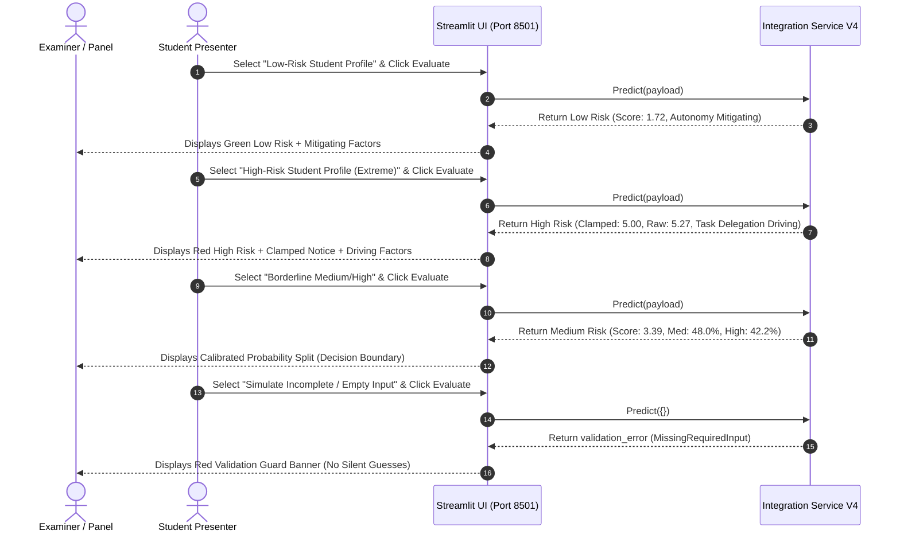

# COMPONENT 1: LIVE DEMONSTRATION CHECKLIST & SCREENSHOT GUIDE
## Presentation Guide for University Progress Evaluation Panel

**Project Title:** Explainable Cognitive Offloading Risk Model — J26-DS-310  
**Component:** Component 1 (Individual Undergraduate Research Project)  
**Student Name:** Hirusha Thisayuru Ellawala | **Student ID:** IT23426580  
**Application Endpoint:** `http://localhost:8501`  
**Model Architecture:** Calibrated Thresholded Ridge Regressor (Ordinal Formulation)

---

## 1. Pre-Demonstration Verification Checklist

Execute this 5-minute pre-flight checklist prior to presenting to the evaluation panel:

- [ ] **Check 1: Confirm Python Environment & Dependencies**
  ```bash
  python3 -c "import streamlit, joblib, sklearn, shap, scipy; print('All core libraries available.')"
  ```
- [ ] **Check 2: Verify Artifact Integrity (No Retraining)**
  ```bash
  ls -lh "Model Training/v4_performance_experiments/models/thresholded_ridge_v4.joblib"
  ls -lh "Model Training/v4_performance_experiments/models/pipeline_metadata_v4.json"
  ```
- [ ] **Check 3: Run Automated Reliability Suite**
  ```bash
  python3 "Model Training/v4_performance_experiments/verification/test_complete_integration_workflow_v4.py"
  # Expected: Ran 9 tests in ~0.2s — OK
  ```
- [ ] **Check 4: Run 8-Scenario Regression Test**
  ```bash
  python3 "Model Training/v4_performance_experiments/verification/test_regression_scenarios_v4.py"
  # Expected: ALL 8 REGRESSION SCENARIOS VALIDATED AND PASSED SUCCESSFULLY!
  ```
- [ ] **Check 5: Launch / Verify Live Streamlit UI**
  ```bash
  python3 -m streamlit run "Model Training/v4_performance_experiments/integration/app_ui_v4.py" --server.port 8501 --server.headless true
  # Open in browser: http://localhost:8501
  ```

---

## 2. Live Demonstration Flow for Evaluation Panel

The Streamlit UI has been equipped with a **Quick-Load Test Profile** selector in the sidebar, allowing one-click execution of each demonstration scenario:



---

## 3. Required Screenshot Guide for Progress Report & Slides

Below are the **5 specific screenshots** required for the progress evaluation report, presentation slides, and dissertation documentation. Capture each exactly as instructed:

### Screenshot 1: High-Risk Profile & Range Constraint Clamping Demonstration
- **File Name to Save:** `screenshot_01_high_risk_clamped_score.png`
- **Preset to Select:** `"High-Risk Student Profile (Extreme)"` from sidebar dropdown.
- **Action:** Click the red **"Evaluate Cognitive Offloading Risk"** button.
- **Exact Elements to Capture in Frame:**
  1. Header with research disclaimer: *"⚠️ RESEARCH DISCLAIMER: This risk prediction is generated by an academic machine learning model..."*
  2. The three top metric cards:
     - **Predicted Risk Category:** `High`
     - **Continuous Construct Score:** `5.00 / 5.0`
     - **Calibrated Confidence:** `99.9%`
  3. The blue info callout banner directly below the metrics:  
     *“ℹ️ **Score Range Notice:** The raw latent linear regression prediction (5.265) fell outside the theoretical Likert domain [1.0, 5.0] and has been clamped to **5.00** in accordance with the construct contract. The raw estimate is preserved for statistical audit.”*
  4. The bar chart showing `High (> 3.500)` tier probability at $> 99\%$.
  5. The LinearSHAP table displaying top risk drivers (`Q20_task_delegation_freq`, `tool_perplexity`, `ai_usage_freq`).
- **Academic Defense Talking Point:**  
  *“Our Ridge regression model accurately captures the severe elevation in latent cognitive offloading risk, but strictly respects the mathematical contract of the unweighted Likert construct by clamping the user-facing score to 5.00 while preserving the raw 5.265 linear estimate for auditability.”*

---

### Screenshot 2: Low-Risk Profile & Protective Autonomy Explanations
- **File Name to Save:** `screenshot_02_low_risk_protective_shap.png`
- **Preset to Select:** `"Low-Risk Student Profile"` from sidebar dropdown.
- **Action:** Click **"Evaluate Cognitive Offloading Risk"**.
- **Exact Elements to Capture in Frame:**
  1. The three metric cards:
     - **Predicted Risk Category:** `Low`
     - **Continuous Construct Score:** `1.72 / 5.0`
     - **Calibrated Confidence:** `95.4%`
  2. The bar chart showing `Low (<= 2.667)` tier probability at $95.4\%$.
  3. The **Leading Explanatory Antecedents (LinearSHAP)** table clearly showing protective features:
     - `Q8_complete_without_ai` (student value 5.0, negative contribution mitigating risk)
     - `Q7_attempt_independently` (student value 5.0, negative contribution)
     - `Q2_verify_info` (student value 5.0, negative contribution)
- **Academic Defense Talking Point:**  
  *“Notice how the LinearSHAP explanations provide actionable educational insights: high academic autonomy and independent attempt frequency strongly push predicted risk down, validating self-determination and cognitive load theory.”*

---

### Screenshot 3: Borderline Decision Boundary & Probability Distribution
- **File Name to Save:** `screenshot_03_borderline_probability_distribution.png`
- **Preset to Select:** `"Borderline Medium/High (Score ~3.39)"` from sidebar dropdown.
- **Action:** Click **"Evaluate Cognitive Offloading Risk"**.
- **Exact Elements to Capture in Frame:**
  1. Metric cards: Category `Medium`, Score `3.39 / 5.0`, Confidence `48.0%`.
  2. The **Calibrated Probability Distribution** bar chart showing split uncertainty:
     - `Medium (2.668 - 3.500)`: $\approx 48.0\%$
     - `High (> 3.500)`: $\approx 42.2\%$
     - `Low (<= 2.667)`: $\approx 9.8\%$
- **Academic Defense Talking Point:**  
  *“When a student scores near the 3.500 tertile boundary, our model transparently surfaces classification uncertainty via the predictive density distribution rather than forcing a misleading overconfident binary classification.”*

---

### Screenshot 4: Input Validation Guard Demonstration (Empty Input Rejection)
- **File Name to Save:** `screenshot_04_validation_guard_empty_rejection.png`
- **Preset to Select:** `"Simulate Incomplete / Empty Input"` from sidebar dropdown.
- **Action:** Click **"Evaluate Cognitive Offloading Risk"**.
- **Exact Elements to Capture in Frame:**
  1. The red error banner:  
     *“❌ Validation Error: Empty input provided. A cognitive offloading assessment requires at least one answered student habit or academic question. Empty submissions cannot be evaluated.”*
  2. The yellow warning callout:  
     *“⚠️ Submission was empty or lacked recognizable student habit responses. The model does not silently evaluate non-existent students.”*
  3. Absence of any fabricated risk score or metric card.
- **Academic Defense Talking Point:**  
  *“Unlike earlier prototypes that silently imputed peer medians and manufactured a false Medium Risk assessment for blank submissions, Version 4 enforces strict input validation guards to prevent misleading evaluations.”*

---

### Screenshot 5: Preprocessing Robustness & Defensive Preprocessing Audit
- **File Name to Save:** `screenshot_05_dirty_input_defensive_warnings.png`
- **Preset to Select:** `"Simulate Dirty Input (NaN/Inf/Out-of-Range)"` from sidebar dropdown.
- **Action:** Click **"Evaluate Cognitive Offloading Risk"**, then expand the **"Data Preprocessing & Validation Notes"** expander at the bottom.
- **Exact Elements to Capture in Frame:**
  1. Successful completion of prediction (`High Risk`, Score `3.77 / 5.0`).
  2. Expanded **Data Preprocessing & Validation Notes** showing the audit list:
     - *“- Encountered +Infinity for 'ai_time_per_week'; clamped to upper domain boundary (5.0).”*
     - *“- Out-of-range numerical value (99.0) for 'Q1_direct_use_freq' clamped to valid domain [1.0, 5.0].”*
     - *“- Invalid text 'unparseable_text_token' for 'Q20_task_delegation_freq'; fell back safely to peer cohort median (3.00).”*
     - *“- Encountered -Infinity for 'Q8_complete_without_ai'; clamped to lower domain boundary (1.0).”*
     - *“- Handled 62 missing optional features using peer cohort training medians.”*
- **Academic Defense Talking Point:**  
  *“In a production deployment, students and external clients will supply imperfect inputs. Version 4 provides industrial-grade resilience: clamping infinities, safely coercing unparseable text, and logging every transformation in an audit log without throwing unhandled exceptions.”*

---

## 4. Summary Table of Demonstration Scenarios

| Scenario | Preset Name | Target Category | Bounded Score | Raw Latent Score | Key Panel Message |
|:---:|---|:---:|:---:|:---:|---|
| **1** | Low-Risk Student Profile | **Low** | **1.72 / 5.0** | 1.724 | Autonomy and verification mitigate offloading risk. |
| **2** | High-Risk Student Profile | **High** | **5.00 / 5.0** | **5.265** | Range constraint enforced; raw estimate preserved for audit. |
| **3** | Borderline Medium/High | **Medium** | **3.39 / 5.0** | 3.390 | Probability distribution captures decision uncertainty. |
| **4** | Simulate Incomplete / Empty | *Error* | *None* | *None* | Empty submissions rejected; no silent hallucinations. |
| **5** | Simulate Dirty Input | **High** | **3.77 / 5.0** | 3.767 | Robust defensive handling of NaNs, infinities, and bad text. |

---

## 5. Live Demonstration Command Reference

```bash
# Terminal command to launch Streamlit dashboard:
cd "/Users/hirushathisayuruellawala/Downloads/PP1 Documents/Model Training/v4_performance_experiments/integration"
python3 -m streamlit run app_ui_v4.py --server.port 8501

# Terminal command to run Fast API backend (if testing REST endpoints):
uvicorn api_v4:app --host 0.0.0.0 --port 8000
```
