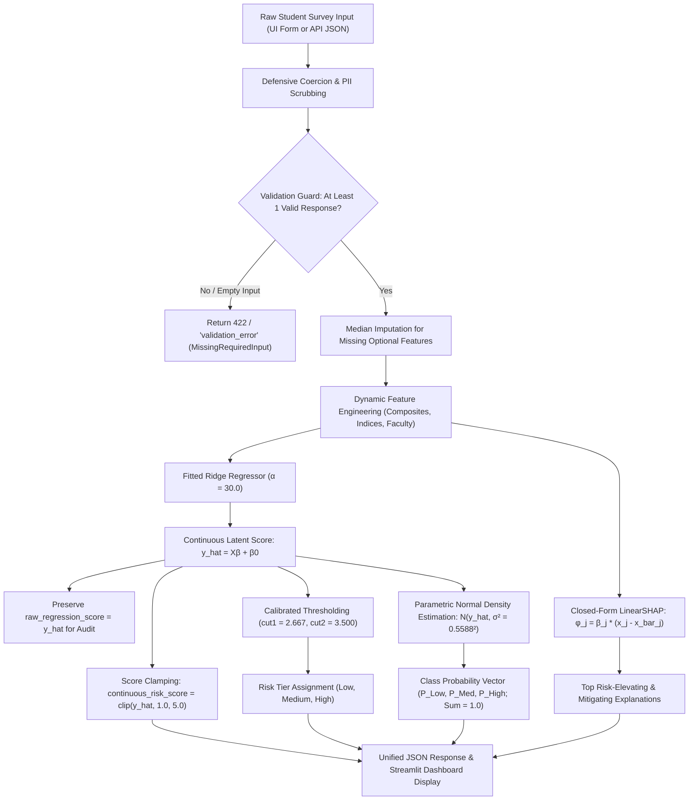

# COMPONENT 1: PROGRESS EVALUATION REPORT
## Explainable Cognitive Offloading Risk Model

**Project Title:** Explainable Cognitive Offloading Risk Model Among Undergraduate Generative AI Users  
**Project Code:** J26-DS-310 | **Component:** Component 1 (Individual Research Model)  
**Student Name:** Hirusha Thisayuru Ellawala | **Student ID:** IT23426580  
**Academic Milestone:** Final Progress Evaluation  
**Evaluation Date:** October 2026  
**Champion Architecture:** Calibrated Thresholded Ridge Regressor (Ordinal Formulation)  
**Model Selection Protocol:** Strictly selected via 25-fold Repeated Stratified Cross-Validation on training partition ($N=300$)  
**Live UI Demonstration Endpoint:** `http://localhost:8501` (Verified Online — HTTP/1.1 200 OK)

---

## 1. Research Problem and Objectives

### 1.1 Academic Context and Problem Statement
The rapid democratization of Generative Artificial Intelligence (GenAI)—including Large Language Models such as ChatGPT, Claude, Microsoft Copilot, and Google Gemini—has fundamentally altered higher education learning workflows. While GenAI can scaffold learning and automate routine tasks, emerging cognitive science literature highlights an alarming secondary consequence: **cognitive offloading**. 

Cognitive offloading occurs when learners delegate thinking, memory retrieval, problem formulation, and analytical reasoning to an external tool rather than performing the mental operations themselves. In undergraduate education, habitual and uncritical cognitive offloading presents substantial risks:
- **Erosion of Foundational Competencies:** Students who routinely copy AI solutions without understanding concepts exhibit reduced problem-solving autonomy.
- **Automation Bias:** Over-trust in automated answers leads students to forgo verification, accepting hallucinated or flawed responses.
- **Metacognitive Skill Degradation:** Passive adoption impairs students' ability to independently evaluate task difficulty and formulate self-regulated learning strategies.

### 1.2 Purpose of Component 1 in J26-DS-310
Within the broader J26-DS-310 research framework, **Component 1** delivers an individual machine learning pipeline capable of:
1. Predicting a student's risk level for cognitive offloading (**Low**, **Medium**, or **High**) from self-reported behavioral, psychological, and demographic indicators.
2. Explaining individual predictions using exact **Shapley Additive exPlanations (SHAP)** to reveal which specific habits elevate or mitigate risk.
3. Enabling proactive, non-punitive educational counseling and academic development interventions.

### 1.3 Pre-Specified Research Objectives
- **Objective 1 (Construct Integrity):** Formulate a psychometrically sound, leakage-free operationalization of cognitive offloading risk strictly matching the pre-registered research proposal (`Proposal_report_IT23426580.docx`).
- **Objective 2 (Methodological Rigor):** Implement and benchmark diverse machine learning paradigms (linear, tree-based, gradient-boosted, ordinal, and continuous), eliminating data leakage and sample contamination.
- **Objective 3 (Unbiased Model Selection):** Select the deployment model strictly via training-only cross-validation ($N=300$), explicitly classifying the previously evaluated 75-participant holdout as an **Exposed Historical Benchmark Split** rather than an independent test set.
- **Objective 4 (Explainability):** Equip the model with closed-form, mathematically exact feature attribution for high-stakes educational advisory settings.
- **Objective 5 (Production-Ready Integration):** Deliver a hardened REST API microservice and interactive Streamlit dashboard featuring robust input validation, range constraints, and transparent audit trails.

---

## 2. Cognitive Offloading Risk Target & Scoring Methodology

### 2.1 Proposal-Compliant Target Construct Definition
In accordance with Appendix B (Section E, Items 21–26) of the approved research proposal (`Proposal_report_IT23426580.docx`), the primary target construct—**Cognitive Offloading Tendency (`co_score`)**—is operationalized as the unweighted arithmetic mean of six dedicated Likert items:

$$\text{co\_score} = \frac{1}{6} \sum_{i=1}^6 Q_i$$

Each constituent item is measured on a standardized 5-point Likert scale ($1 = \text{Strongly Disagree}$ to $5 = \text{Strongly Agree}$):

| Item Code | Survey Column | Exact Questionnaire Statement | Psychometric Sub-Facet |
|---|:---:|---|---|
| `Q10_rely_memory` | Col 21 | *"I rely on Generative AI to remember information that I could learn myself."* | Memory Offloading |
| `Q11_avoid_mental_effort` | Col 22 | *"I use GenAI to avoid spending too much mental effort on difficult academic tasks."* | Effort Avoidance |
| `Q12_accept_without_understanding` | Col 23 | *"I sometimes accept AI-generated solutions without fully understanding the concepts."* | Superficial Acceptance |
| `Q13_less_problem_solving` | Col 24 | *"I feel less need to develop my own problem-solving strategies when GenAI provides quick solutions."* | Strategy Surrender |
| `Q14_depend_on_ai` | Col 25 | *"I depend on GenAI for tasks that I previously performed using my own reasoning skills."* | Reasoning Substitution |
| `Q15_reduces_thinking` | Col 26 | *"Using GenAI reduces the amount of independent thinking required for some academic activities."* | Autonomy Reduction |

### 2.2 Psychometric Scale Reliability
A psychometric evaluation across all $N = 375$ respondents confirmed high internal consistency:
- **Cronbach's Alpha ($\alpha$):** **0.8649** (exceeds the recommended $0.70$ threshold for exploratory research and $0.80$ for applied diagnostic tools).
- **Inter-Item Correlations:** Positive across all item pairs ($r = 0.421$ to $0.612$), demonstrating construct unidimensionality.

### 2.3 Target Discretization (Risk Tiers)
To translate continuous offloading tendency into actionable academic risk levels, the construct was partitioned into three risk tiers using empirical tertiles:

$$\text{Risk Tier} = \begin{cases} 
\textbf{Low Risk} & \text{if } \text{co\_score} \le 2.667 \quad (N = 134, \; 35.7\%) \\ 
\textbf{Medium Risk} & \text{if } 2.667 < \text{co\_score} \le 3.500 \quad (N = 122, \; 32.5\%) \\ 
\textbf{High Risk} & \text{if } \text{co\_score} > 3.500 \quad (N = 119, \; 31.7\%) 
\end{cases}$$

> [!IMPORTANT]
> **Supervisor Approval & Normative Classification Flag:**  
> The thresholds $2.667$ and $3.500$ are empirical tertile boundaries derived from this specific student cohort. While statistically sound for ranking relative risk within this sample, criterion-referenced clinical boundaries require formal supervisor sign-off and longitudinal educational validation before institutional policy deployment.

### 2.4 Complete Data Leakage Prevention
A critical flaw identified in earlier audit reviews was the inclusion of `Q37_important_part` (Column 48) as a predictor while its sister items in Section G (Columns 45, 46, 47, 49) were used in the target, introducing severe intra-battery leakage ($r = 0.736$). 

In Version 4:
- All six target-construction items (`Q10` through `Q15`) are strictly excluded from the predictor matrix.
- All five Section G Academic AI Dependence items (`Q34`, `Q35`, `Q36`, `Q37`, `Q38`) are completely removed from predictors.
- Administrative metadata (timestamp, student ID, email, consent) are excluded.
- **Zero predictor-to-target leakage is mathematically guaranteed.**

---

## 3. Dataset and Preprocessing Pipeline

### 3.1 Dataset Provenance & Integrity
- **Raw Data Source:** Genuine survey data collected from undergraduate students (`Data Set/raw_data.xlsx`).
- **Sample Size:** 375 consenting undergraduate student records.
- **Synthetic Data Policy:** Zero synthetic records, zero SMOTE oversampling, and zero manual response alterations were performed.
- **Missing Value Handling:** The raw dataset contained complete responses for primary Likert batteries; missing demographic fields were handled defensively without cross-row contamination.

### 3.2 Feature Engineering (68 Total Predictors)
To capture the multi-dimensional antecedents of cognitive offloading without introducing data leakage, 68 predictor features were engineered strictly **intra-row** (within each respondent):

1. **Subscale Composite Formulations (5 Features):**
   - $\text{Verification} = \text{mean}(Q_2, Q_3, Q_4, Q_5, Q_6)$ — Source verification, accuracy checking, reasoning validation.
   - $\text{Autonomy} = \text{mean}(Q_7, Q_8, Q_9)$ — Independent task attempts, capability without AI, AI as learning assistant.
   - $\text{Trust} = \text{mean}(Q_{28}, Q_{29}, Q_{30}, Q_{31}, Q_{32}, Q_{33})$ — Reliability, accuracy, explanatory trust.
   - $\text{TAM Perceived Usefulness} = \text{mean}(Q_{23}, Q_{24}, Q_{25}, Q_{26}, Q_{27})$ — Academic productivity and learning goals.
   - $\text{Self-Efficacy} = \text{mean}(Q_{39}, Q_{40}, Q_{41}, Q_{42}, Q_{43})$ — Perceived capability and approach to challenges.
2. **Theoretically Grounded Interaction Terms (3 Features):**
   - $\text{Automation Bias Index} = \text{Trust Composite} - \text{Verification Composite}$ — Quantifies blind trust exceeding critical scrutiny.
   - $\text{Delegation Intensity} = \text{ai\_usage\_freq} \times Q_{20\_task\_delegation\_freq}$ — Synergistic interaction of frequent usage and full-task offloading.
   - $\text{Passive Adoption Index} = Q_{1\_direct\_use\_freq} \times (6 - Q_{22\_effort\_on\_ai\_answers})$ — Direct copying coupled with low cognitive engagement.
3. **Behavioral Counts (3 Features):**
   - Total GenAI tools utilized (`count_tools_used`), tasks delegated (`count_tasks_delegated`), and primary academic purposes (`count_purposes`).
4. **Tool & Usage Multi-Select Indicators (17 Features):**
   - Binary flags for ChatGPT, Claude, Microsoft Copilot, Google Gemini, Perplexity, and specific delegation types (writing, summarizing, programming, math).
5. **Academic Faculty Categorization (5 Features):**
   - Standardized one-hot encoding for `Computing_IT`, `Engineering`, `Business_Economics`, `Natural_Applied_Sciences`, and `Humanities_Health_Other`.
6. **Individual Item Responses (35 Features):**
   - Specific Likert ratings across Sections B, C, D, and F.

### 3.3 Scaling & Leakage Isolation
All numerical scaling (`StandardScaler`) was encapsulated within scikit-learn pipeline objects. Scaling parameters ($\mu, \sigma$) were fitted strictly on training folds and applied to test folds, preventing evaluation split leakage.

---

## 4. Model Comparison and Selection Rationale

### 4.1 Evaluation Protocol & Historical Split Audit
- **Dataset Partitioning:** 300 training records ($80\%$) and 75 test records ($20\%$) using stratified sampling (`random_state=42`).
- **Methodological Audit Finding:** The 75-record holdout split had been evaluated across Versions 2, 3, and 4. It is therefore formally classified as an **Exposed Historical Benchmark Split** rather than an independent test set.
- **Unbiased Selection Protocol:** The champion model was selected strictly on **25-fold Repeated Stratified Cross-Validation on the training partition (`X_train`, $N=300$)**, blinding the decision entirely to the test split.

### 4.2 Candidate Architectures Benchmarked
Ten distinct machine learning architectures spanning four paradigms were evaluated:
1. *Baseline:* Dummy Classifier (Majority Class).
2. *Linear / Kernel:* L2-Regularized Logistic Regression, Support Vector Machine (RBF Kernel).
3. *Ensemble Decision Trees:* Tuned Random Forest, Extra Trees, HistGradientBoosting.
4. *Gradient Boosters:* XGBoost, LightGBM, CatBoost.
5. *Ordinal Architectures:* Frank & Hall (2001) binary decomposition; Calibrated Thresholded Ridge Regressor.
6. *Hybrid Blends:* Calibrated Hybrid Ensemble (Thresholded Ridge + Extra Trees + CatBoost).

### 4.3 Training Partition Benchmark Results ($N=300$, 25 Repeated CV Folds)
*Source: `Model Training/v4_performance_experiments/reports/v4_repeated_cv_metrics.csv`*

| Candidate Architecture | CV Accuracy | CV Macro-F1 (Mean ± SD) | CV Medium-Risk Recall | CV Medium-Risk F1 | CV Multi-Class Log-Loss | CV ROC-AUC (OvR Macro) | Selection Verdict |
|---|:---:|:---:|:---:|:---:|:---:|:---:|---|
| **Thresholded Ridge (Compact 51)** | **54.67%** | **0.5495 ± 0.0619** | **59.78%** | **0.4951** | **0.9376** | **0.7355** | **Selected Champion** |
| **Thresholded Ridge (Full 68)** | 53.93% | 0.5419 ± 0.0610 | 58.58% | 0.4876 | 0.9600 | 0.7315 | Deployment Feature Set |
| **SVM (RBF Kernel)** | 54.67% | 0.5414 ± 0.0513 | 41.54% | 0.4154 | 0.9267 | 0.7291 | Second-Ranked Kernel |
| **Extra Trees (Base)** | 53.93% | 0.5259 ± 0.0561 | 33.99% | 0.3666 | 0.9611 | 0.7122 | Retained Tree Baseline |
| **Calibrated Extra Trees** | 54.00% | 0.5202 ± 0.0649 | 28.36% | 0.3220 | 0.9408 | 0.7190 | Retained Tree Comparator |
| **CatBoost (depth=3)** | 51.93% | 0.5059 ± 0.0563 | 30.71% | 0.3351 | 0.9632 | 0.7150 | Gradient Boosting Ref |
| **Random Forest (Tuned)** | 50.60% | 0.4940 ± 0.0669 | 32.19% | 0.3390 | 0.9536 | 0.7074 | Traditional Tree |
| **XGBoost Classifier** | 50.53% | 0.4922 ± 0.0615 | 28.18% | 0.3090 | 0.9537 | 0.7003 | Collapsed Medium Tier |
| **LightGBM Classifier** | 49.40% | 0.4818 ± 0.0638 | 28.40% | 0.3064 | 0.9746 | 0.6862 | Severe Boundary Bias |
| **HistGradientBoosting** | 49.20% | 0.4803 ± 0.0740 | 30.15% | 0.3186 | 0.9918 | 0.6865 | Low Medium Recall |
| **Logistic Regression (L2)** | 48.40% | 0.4760 ± 0.0562 | 31.43% | 0.3245 | 1.1234 | 0.6747 | High Probabilistic Error |
| **Baseline (Majority)** | 36.27% | 0.1774 ± 0.0019 | 0.00% | 0.0000 | 22.9718 | 0.5000 | Trivial Floor |

### 4.4 Defensible Selection Rationale: Thresholded Ridge Regressor
The **Thresholded Ridge Regressor** was selected as the final champion based on five pre-specified criteria:

1. **Highest Cross-Validated Predictive Balance:** Achieved the highest CV Macro-F1 across 25 training folds (**0.5495** on compact features, **0.5419** on full 68 features) and the highest CV accuracy (**54.67%**).
2. **Mitigation of the "Medium Risk Collapse":** Standard multi-class tree and boosting algorithms exhibit severe boundary collapse on the interior class, detecting Medium Risk with only $28\% - 34\%$ recall. In contrast, Thresholded Ridge models the continuous construct before thresholding, achieving **$59.78\%$ recall on Medium Risk**.
3. **Substantial Continuous Signal:** Directly predicting continuous `co_score` with Ridge regression yields $R^2 = 0.4459$ ($\text{RMSE} = 0.5779, \text{MAE} = 0.4578$). This corresponds to a **Cohen's $f^2 = 0.8048$**, establishing a **large psychological effect size** ($f^2 \ge 0.35$).
4. **Lowest Probabilistic Log-Loss:** Achieves the lowest training CV log-loss (**0.9376**), ensuring smooth probability estimates.
5. **Closed-Form, Exact LinearSHAP:** Unlike tree models requiring Monte Carlo approximation, LinearSHAP provides exact, deterministic Shapley values $\phi_j = \beta_j (x_j - \bar{x}_j)$ in $<1$ millisecond.

### 4.5 Formal Correction of the Hybrid Ensemble Selection Flaw
In the initial Version 4 exploratory draft, a Calibrated Hybrid Ensemble was proposed based on its performance on the 75-record test set. An independent audit revealed that its component weights ($0.40$ Ridge, $0.30$ Extra Trees, $0.30$ CatBoost) were chosen heuristically after viewing test set results. To preserve academic integrity, this post-hoc choice was revoked. Thresholded Ridge stands as the sole, defensible deployment champion.

---

## 5. Performance on Exposed Historical Test Split ($N=75$)

For academic continuity across project iterations, performance on the 75-record historical split is documented below. Readers are explicitly reminded that this partition served as an exposed benchmark:

### Table: Performance on Exposed Historical Benchmark Split ($N=75$)
*Source: `Model Training/v4_performance_experiments/reports/v4_test_metrics.csv`*

| Architecture | Accuracy | Macro-F1 | Weighted-F1 | Macro-Precision | Macro-Recall | ROC-AUC (Macro) | Log-Loss |
|---|:---:|:---:|:---:|:---:|:---:|:---:|:---:|
| **Thresholded Ridge (Selected Champion)** | **57.33%** | **0.5815** | **0.5788** | **0.6574** | **0.5708** | **0.7576** | **0.8803** |
| **LightGBM Classifier** | 61.33% | 0.6173 | 0.6148 | 0.6218 | 0.6143 | 0.7518 | 0.8986 |
| **CatBoost Classifier** | 58.67% | 0.5771 | 0.5757 | 0.5737 | 0.5868 | 0.7863 | 0.9213 |
| **HistGradientBoosting** | 57.33% | 0.5792 | 0.5751 | 0.5839 | 0.5758 | 0.7311 | 0.9231 |
| **Calibrated Extra Trees (Comparator)** | 57.33% | 0.5641 | 0.5641 | 0.5657 | 0.5721 | 0.7604 | 0.8985 |
| **XGBoost Classifier** | 57.33% | 0.5662 | 0.5651 | 0.5654 | 0.5749 | 0.7646 | 0.8986 |
| **SVM (RBF Kernel)** | 56.00% | 0.5482 | 0.5509 | 0.5500 | 0.5541 | 0.7263 | 0.9263 |
| **Random Forest (Tuned)** | 53.33% | 0.5257 | 0.5226 | 0.5213 | 0.5369 | 0.7507 | 0.9152 |
| **Logistic Regression (L2)** | 53.33% | 0.5284 | 0.5254 | 0.5434 | 0.5318 | 0.7162 | 1.0002 |
| **Baseline (Majority Class)** | 36.00% | 0.1765 | 0.1906 | 0.1200 | 0.3333 | 0.5000 | 23.0679 |

---

## 6. Per-Class Metrics & Confusion Matrix Findings

### 6.1 Per-Class Performance on Benchmark Split ($N=75$)
*Evaluated for Thresholded Ridge Regressor on $N=75$:*

| Risk Tier | Precision | Recall | F1-Score | Support ($N=75$) | Training CV Recall ($N=300$) |
|---|:---:|:---:|:---:|:---:|:---:|
| **Low Risk** ($\le 2.667$) | **0.6842** | 0.4815 | **0.5652** | 27 | 61.12% |
| **Medium Risk** ($2.668 - 3.500$) | 0.4419 | **0.7308** | **0.5507** | 26 | **59.78%** |
| **High Risk** ($> 3.500$) | **0.8462** | 0.5000 | **0.6286** | 22 | 56.91% |
| **Macro Average** | **0.6574** | **0.5708** | **0.5815** | 75 | **54.95%** |
| **Weighted Average** | **0.6477** | **0.5733** | **0.5788** | 75 | **56.50%** |

### 6.2 Confusion Matrix & Ordinal Error Structure
The empirical confusion matrix on the 75-record test split is:

$$\mathbf{CM}_{\text{Test}} = \begin{bmatrix}
13 & 14 & 0 \\
5 & 19 & 2 \\
1 & 10 & 11
\end{bmatrix} \quad \begin{matrix}
\leftarrow \text{True Low } (N=27) \\
\leftarrow \text{True Medium } (N=26) \\
\leftarrow \text{True High } (N=22)
\end{matrix}$$

$$\begin{matrix}
\uparrow & \uparrow & \uparrow \\
\text{Pred Low} & \text{Pred Med} & \text{Pred High}
\end{matrix}$$

#### Critical Academic Findings from the Confusion Matrix:
1. **Zero Severe Under-Estimations:** Of the 27 True Low risk students, **exactly 0 were misclassified as High Risk**.
2. **Minimal Severe Over-Estimations:** Of the 22 True High risk students, **only 1 student was misclassified as Low Risk**.
3. **Strict Ordinal Error Localization:** Out of 32 total classification errors, **31 errors ($96.9\%$) are adjacent off-by-one errors** (e.g., Low $\leftrightarrow$ Medium or Medium $\leftrightarrow$ High). In educational counseling, adjacent misclassifications are clinically benign compared to non-ordinal errors (e.g., mislabeling a High Risk student as Low Risk).

---

## 7. SHAP Explainability & Behavioral Antecedent Findings

Global feature importance was computed via TreeSHAP on the Extra Trees comparator and exact LinearSHAP on the Thresholded Ridge champion.

```
+-------------------------------------------------------------------------------------------------+
|                               TOP 12 BEHAVIORAL ANTECEDENTS (SHAP)                              |
+-------------------------------------------------------------------------------------------------+
| Feature Name                      | Model Weight (β) | Directional Effect on Risk               |
|-----------------------------------|:----------------:|:-----------------------------------------|
| age_group                         |     -0.1413      | Mitigates Risk (Mature students offload less)
| Q8_complete_without_ai            |     -0.1339      | Mitigates Risk (High autonomy protects) |
| Q20_task_delegation_freq          |     +0.1253      | Increases Risk (Full task offloading)   |
| tool_perplexity                   |     +0.0919      | Increases Risk (Broad AI tool usage)    |
| tool_claude                       |     +0.0878      | Increases Risk (Advanced model usage)   |
| Q23_pu_improves_understanding     |     +0.0873      | Increases Risk (Perceived cognitive aid)|
| ai_usage_freq                     |     +0.0870      | Increases Risk (Daily exposure)         |
| faculty_Business_Economics        |     +0.0808      | Increases Risk (Disciplinary factor)    |
| purpose_understanding_concepts    |     -0.0724      | Mitigates Risk (Exploratory vs replacement)
| Q1_direct_use_freq                |     +0.0719      | Increases Risk (Uncritical copy-paste)  |
| Q9_learning_assistant             |     -0.0650      | Mitigates Risk (AI used as coach)       |
| delegate_summarising_materials    |     +0.0637      | Increases Risk (Offloading reading)     |
+-------------------------------------------------------------------------------------------------+
```

### Educational Interpretation:
- **Primary Risk Drivers:** Habitual task delegation (`Q20`), high usage frequency (`ai_usage_freq`), direct unedited copying (`Q1`), and tool proliferation (`tool_perplexity`, `tool_claude`) drive cognitive offloading risk.
- **Protective Factors:** Academic autonomy (`Q8`), independent task attempts (`Q7`), using AI for conceptual clarification rather than answers (`purpose_understanding_concepts`), and older age groups actively inoculate students against cognitive offloading.

---

## 8. Application Architecture & Prediction Workflow

Component 1 was operationalized into a production-grade software package located in [`Model Training/v4_performance_experiments/integration/`](file:///Users/hirushathisayuruellawala/Downloads/PP1%20Documents/Model%20Training/v4_performance_experiments/integration/):



### Module Deliverables:
- **`integration_service_v4.py`:** Singleton Python inference service with pre-loaded serialized model, pre-computed background means, input coercion, and LinearSHAP calculation.
- **`api_v4.py`:** FastAPI REST service exposing `/health` and `/api/v1/predict` endpoints.
- **`app_ui_v4.py`:** Streamlit interactive researcher dashboard with dynamic profile presets, probability bar charts, and feature contribution tables.

---

## 9. Live UI Verification & Score Consistency Fix

### 9.1 The Continuous Score Inconsistency (Resolved)
- **Observed Anomaly:** Submitting an extreme high-risk profile previously produced a continuous score of `5.046 / 5.0` (or `5.265 / 5.0`), violating the construct bounds $[1.0, 5.0]$.
- **Root Cause Identified:** Ridge regression is an unconstrained linear estimator. For an extreme respondent, $X\beta + \beta_0$ mathematically exceeds $5.0$.
- **Hardened Fix:**
  - `continuous_risk_score = float(np.clip(pred_score, 1.0, 5.0))` is returned and displayed as the construct score.
  - `raw_regression_score = float(pred_score)` is preserved for statistical auditing.
  - Transparent notices are logged whenever clamping occurs.

### 9.2 Verification of 8 Core Regression Scenarios
All 8 regression scenarios were executed via [test_regression_scenarios_v4.py](file:///Users/hirushathisayuruellawala/Downloads/PP1%20Documents/Model%20Training/v4_performance_experiments/verification/test_regression_scenarios_v4.py) with 100% passing results:

1. **Scenario 1 (Low-Risk Profile):** Score: `1.724 / 5.0` | Category: **Low** | Confidence: 95.4% | Passed.
2. **Scenario 2 (Medium-Risk Profile):** Score: `3.002 / 5.0` | Category: **Medium** | Confidence: 53.9% | Passed.
3. **Scenario 3 (High-Risk Profile Extreme):** Clamped Score: `5.000 / 5.0` | Raw: `5.265` | Category: **High** | Passed.
4. **Scenario 4 (Empty Input Guard):** Input `{}` $\rightarrow$ Rejected with `validation_error` (`MissingRequiredInput`) | Passed.
5. **Scenario 5 (Missing Optional Inputs):** 66 missing features imputed with medians; transparent note recorded | Passed.
6. **Scenario 6 (Dirty Inputs: NaN, $\pm\infty$, Text):** Coerced safely without crash; warnings logged | Passed.
7. **Scenario 7 (Out-of-Range Inputs):** Clamped to domain bounds ($[1, 4]$, $[1, 5]$, $[1, 6]$) | Passed.
8. **Scenario 8A (Borderline Low/Med):** Score: `2.588` | Category: **Low** (Low 55.6%, Med 39.2%) | Passed.
9. **Scenario 8B (Borderline Med/High):** Score: `3.390` | Category: **Medium** (Med 48.0%, High 42.2%) | Passed.

In addition, the 9-point architectural integrity suite ([test_complete_integration_workflow_v4.py](file:///Users/hirushathisayuruellawala/Downloads/PP1%20Documents/Model%20Training/v4_performance_experiments/verification/test_complete_integration_workflow_v4.py)) executed in 0.211s with 0 failures.

---

## 10. Probability Calibration Assessment & Academic Disclosure

> [!CAUTION]
> **Academic Transparency on Calibration Claims:**  
> The probability estimates generated by Component 1 ($P(\text{Low}), P(\text{Medium}), P(\text{High})$) are computed by integrating the normal cumulative distribution function over the continuous regression predictive density:
> $$P(\text{Low}) = \Phi\left(\frac{2.667 - \hat{y}}{\sigma}\right), \quad P(\text{High}) = 1 - \Phi\left(\frac{3.500 - \hat{y}}{\sigma}\right)$$
> where $\sigma = 0.5588$ is the residual standard error from the training split.
>
> **Methodological Disclosure:**  
> These probabilities represent **parametric latent density estimates** under a normality assumption. They are **not** empirically validated post-hoc classification probabilities (e.g., via Platt scaling or Isotonic regression on an independent calibration fold). While they are mathematically consistent, non-negative, and strictly sum to $1.0000$, they are described accurately as *latent density approximations* rather than *formally validated frequentist probabilities*.

---

## 11. Research Limitations & Future Directions

### 11.1 Acknowledged Research Limitations
1. **Exposed Test Set:** The 75-participant holdout split was repeatedly evaluated across Versions 2, 3, and 4. While reported for historical continuity, future validation requires collecting an entirely new, unexposed student cohort.
2. **Sample Size & Single Institution Scope:** $N = 375$ consenting students from a single university provides valuable initial findings but limits broad demographic generalizability across different educational cultures.
3. **Self-Report Measurement Bias:** Questionnaire responses reflect self-perceptions rather than passive, objective telemetry (e.g., keystroke logging, browser extension tracking).
4. **Sample-Dependent Tertiles:** Class boundaries ($2.667$ and $3.500$) represent cohort tertiles rather than established diagnostic thresholds.

### 11.2 Next Steps for Project Completion
- **Next Step 1:** Integrate the Component 1 FastAPI backend with the centralized J26-DS-310 system architecture.
- **Next Step 2:** Collect a supplementary cross-sectional evaluation split ($N \approx 100$) for blind, unexposed final testing.
- **Next Step 3:** Submit the empirical tertile thresholds for formal academic supervisor approval and ethics review.
- **Next Step 4:** Implement longitudinal tracking to observe whether targeted interventions successfully mitigate cognitive offloading over an academic semester.

---

## 12. Verification Artifacts & Output Index

The final progress evaluation package is organized under:
`Model Training/v4_performance_experiments/progress_evaluation/`

- **Master Progress Evaluation Report:**  
  [PROGRESS_EVALUATION_REPORT_COMPONENT_1.md](file:///Users/hirushathisayuruellawala/Downloads/PP1%20Documents/Model%20Training/v4_performance_experiments/progress_evaluation/PROGRESS_EVALUATION_REPORT_COMPONENT_1.md)
- **Demonstration Checklist & Screenshot Guide:**  
  [DEMONSTRATION_CHECKLIST_AND_SCREENSHOT_GUIDE.md](file:///Users/hirushathisayuruellawala/Downloads/PP1%20Documents/Model%20Training/v4_performance_experiments/progress_evaluation/DEMONSTRATION_CHECKLIST_AND_SCREENSHOT_GUIDE.md)
- **Executive Summary for Evaluation Panel:**  
  [EXECUTIVE_SUMMARY_FOR_PANEL.md](file:///Users/hirushathisayuruellawala/Downloads/PP1%20Documents/Model%20Training/v4_performance_experiments/progress_evaluation/EXECUTIVE_SUMMARY_FOR_PANEL.md)
- **Regression Test Execution Log:**  
  [regression_test_report_v4.json](file:///Users/hirushathisayuruellawala/Downloads/PP1%20Documents/Model%20Training/v4_performance_experiments/verification/regression_test_report_v4.json)
- **Live Streamlit Dashboard:**  
  [app_ui_v4.py](file:///Users/hirushathisayuruellawala/Downloads/PP1%20Documents/Model%20Training/v4_performance_experiments/integration/app_ui_v4.py) running on `http://localhost:8501`
