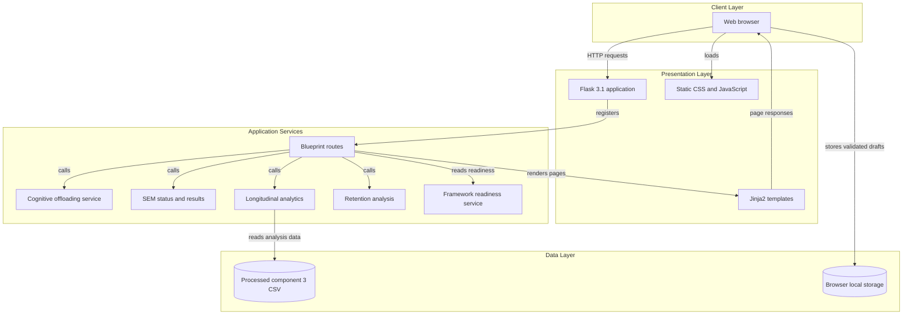
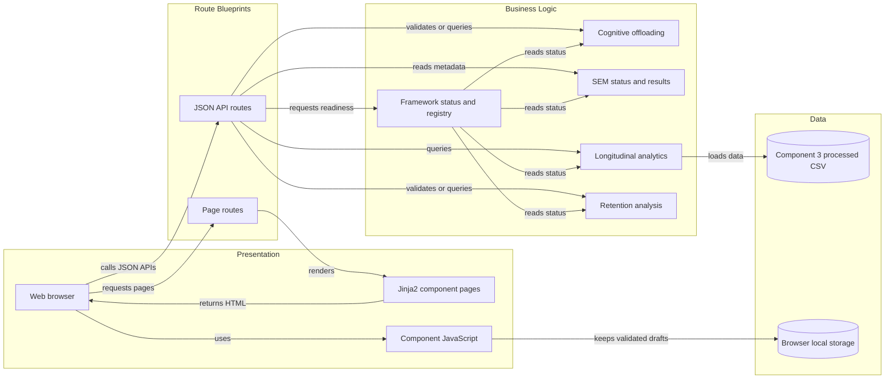

# Architecture – Psychometric Learning Analytics Framework

**Project ID:** J26-DS-310  
**Institution:** SLIIT – Centre of Excellence in Artificial Intelligence (CoEAI)  
**Status:** Prototype scaffold – research data collection in progress

---

## Overview

The Psychometric Learning Analytics Framework is composed of **four fully
independent analytical components**. Each component is self-contained in its
own service layer (`app/services/`) and route blueprint (`app/routes/`), and
produces its own set of analytical outputs.

The outputs of all four components are designed to be **integrated into a
single shared research analytics dashboard** once data collection and analysis
are complete.

---

## Component Independence

Each component operates independently in the following sense:

- It has its own data inputs (separate survey instruments, study diaries,
  experimental outputs).
- It applies its own analytical methodology (ML, SEM, time-series, NLP).
- It produces its own result artefacts (risk predictions, path coefficients,
  trend curves, NLP metrics).
- It is developed by an independent team member.

This independence ensures that delays or changes in one component do not
block the others.

---

## Four Analytical Components

| # | Component | Methodology | Team Member |
|---|-----------|-------------|-------------|
| 1 | Explainable Cognitive Offloading Risk Prediction | Logistic Regression, Random Forest, XGBoost, SHAP | IT23426580 |
| 2 | Algorithmic Trust & Verification Analysis | CFA, SEM, R/lavaan | IT23217904 |
| 3 | Longitudinal Study Pattern Analytics | Time-Series, Trend Analysis, Pandas | IT23426344 |
| 4 | GenAI-Assisted Cognitive Engagement & Retention | NLP, NLTK, spaCy, Statistical Analysis | IT23165220 |

---

## Application Architecture

The Flask application serves the web interface and component APIs. Each research
component has its own service layer; the framework layer reports readiness without
combining component results.

<!-- mermaid-checked: no \n, no em-dash/en-dash, no {} in labels, subgraphs are id["label"], arrows are -->|"label"|, all subgraphs closed by end, ids unique -->


### Technology Stack Summary

| Layer | Technology | Version | Purpose |
|-------|------------|---------|---------|
| Runtime | Python | Not specified | Runs the Flask application and services |
| Web framework | Flask | 3.1.0 | Application factory, routes, and JSON APIs |
| Templates | Jinja2 | Flask dependency | Renders server-side HTML pages |
| Longitudinal analysis | Pandas | Not specified | Reads and analyzes Component 3 CSV data |
| Spreadsheet input | openpyxl | Not specified | Reads weekly Excel input files |
| Front end | HTML, CSS, JavaScript | Not specified | Displays pages and provides browser interactions |

### Data Storage & External Services

The application has no database, cache, or external API integration. Component 3
reads its processed CSV dataset from the local `data/processed/` directory, while
validated Component 3 drafts are kept in browser local storage. R/lavaan analysis
for Component 2 is performed outside the Flask runtime; only validated outputs
are intended for later display.

### Key Architectural Decisions

- The four analytical components have separate routes and service packages.
- The framework status service imports component services directly and reports
  readiness only; it does not create a combined score or model.
- Research submissions are not persisted by the validation APIs.

### Component Relationships

This diagram summarizes the main runtime calls between browser pages, route
blueprints, component services, and the framework readiness service.

<!-- mermaid-checked: no \n, no em-dash/en-dash, no {} in labels, subgraphs are id["label"], arrows are -->|"label"|, all subgraphs closed by end, ids unique -->


### Component Inventory

| Component | Layer | Type | Responsibility |
|-----------|-------|------|----------------|
| Flask blueprint routes | Presentation | Web and API routes | Render pages and expose component endpoints |
| Cognitive offloading service | Business logic | Model service | Reports model readiness; prediction is not yet available |
| SEM analysis service | Business logic | Status and result services | Reports analysis status and gates access to empirical results |
| Longitudinal analytics service | Business logic | Analysis service | Reads processed weekly data and provides analysis summaries |
| Retention analysis service | Business logic | Analysis service | Reports readiness and gates access to experimental results |
| Framework status service | Integration | Readiness service | Reads component readiness without aggregating analytical results |
| Component 3 processed CSV | Data | Local file | Supplies data to longitudinal analysis |
| Browser local storage | Data | Client-side storage | Keeps validated Component 3 drafts in the browser |

---

## Data Flow (planned)

```
[Data Collection]
    ↓
[data/raw/]  (never committed to git)
    ↓
[Preprocessing – notebooks/ or services/]
    ↓
[data/processed/]  (never committed to git)
    ↓
[Component 1–4 Service Layers]
    ↓
[Dashboard – /dashboard]
```

---

## Component 1 Architecture – Cognitive Offloading Risk Prediction

### Target Construction vs. Predictor Preparation Separation

To uphold research integrity and eliminate **data leakage**, the pipeline strictly separates:

```
[Survey Administration]
      │
      ├─────────────────────────────────────────────┐
      ▼                                             ▼
Target Construction Items                     Predictor Items
(validated cognitive offloading scale)         (GenAI usage, verification, independent learning)
      │                                             │
      ▼                                             ▼
Target Variable: Binary / Ordinal Risk        Feature Engineering / Preprocessing
      │                                             │
      └─────────────────────┬───────────────────────┘
                            ▼
                Train / Test Separation
                            ▼
               Stratified Cross-Validation
                            ▼
                     Model Training
          (Logistic Regression, RF, XGBoost)
                            ▼
                     Selected Model
                            ▼
                    SHAP Explainability
                            ▼
                   Dashboard Presentation
```

> **Target Leakage Rule:** Cognitive-offloading scale items used to construct the
> target label are **strictly excluded** from the predictor feature set.

### Service Layer Design

- `schemas.py`: Allowed category enumerations, regex pattern for anonymous participant IDs.
- `validation.py`: Pure validation and sanitization. Rejects any out-of-schema values.
- `model_service.py`: `CognitiveOffloadingModelService` singleton. All prediction methods
  raise `ModelNotAvailableError` until an evaluated model file is loaded.
- `routes/component1.py`:
  - `GET /component1/`: interactive prototype UI
  - `GET /api/component1/status`: reports `model_trained: false`, `prediction_available: false`
  - `POST /api/component1/validate-input`: validates prototype payload; does NOT predict or persist

---

## Component 2 Architecture – Algorithmic Trust & Verification Analysis

### Latent Constructs

Component 2 investigates five theoretical constructs operationalised via psychometric survey scales:

| Code | Construct Name | Role in Structural Model |
|------|----------------|--------------------------|
| **AT** | Algorithmic Trust | Antecedent Construct |
| **PU** | Perceived Usefulness | Antecedent Construct |
| **VB** | Verification Behaviour | Behavioural Mechanism (Mediator) |
| **AD** | AI Dependence | Learning / Reliance Outcome |
| **LC** | Learning Confidence | Learning / Reliance Outcome |

### Methodological Stages

1. **Measurement Model Stage (Confirmatory Factor Analysis):**
   - Evaluates indicator factor loadings ($\lambda \ge 0.70$).
   - Tests construct reliability using Composite Reliability ($\text{CR} \ge 0.70$) and Cronbach's $\alpha \ge 0.70$.
   - Assesses convergent validity via Average Variance Extracted ($\text{AVE} \ge 0.50$).
   - Evaluates discriminant validity using the Fornell-Larcker criterion and Heterotrait-Monotrait ratio ($\text{HTMT} < 0.85 / 0.90$).

2. **Structural Model Stage (Structural Equation Modelling):**
   - Assesses hypothesised direct pathways from antecedents to outcomes.
   - Evaluates overall goodness of fit using $\chi^2/\text{df}$, CFI, TLI, RMSEA, and SRMR.

3. **Mediation Analysis Stage:**
   - Evaluates whether Verification Behaviour serves as an indirect behavioural mechanism linking Algorithmic Trust to AI Dependence and Learning Confidence.
   - Applies non-parametric bootstrapping (5,000 resamples) with 95% bias-corrected confidence intervals.

### Analytical and Architectural Boundary: R/lavaan vs. Flask

A strict separation of concerns is maintained between statistical estimation and web visualization:

```
┌────────────────────────────────────────────────────────┐
│            R / lavaan Research Environment             │
│  - Survey data screening & psychometric cleaning       │
│  - CFA measurement model estimation (MLR estimator)     │
│  - Structural Equation Model path estimation           │
│  - Bootstrapped mediation analysis (5,000 resamples)   │
│  - Parameter estimate & fit index export               │
└───────────────────────────┬────────────────────────────┘
                            │ Validated JSON / CSV export
                            ▼
┌────────────────────────────────────────────────────────┐
│            Flask Web Application Backend               │
│  - `app/services/sem_analysis/schemas.py`: metadata   │
│  - `app/services/sem_analysis/status_service.py`       │
│  - `app/services/sem_analysis/result_service.py`       │
│    (SemResultService raises error if unvalidated)     │
│  - `GET /api/component2/status`                        │
│  - `GET /api/component2/specification`                 │
└───────────────────────────┬────────────────────────────┘
                            ▼
┌────────────────────────────────────────────────────────┐
│          Dashboard Presentation Layer (/component2/)   │
│  - Interactive construct exploration                   │
│  - Planned model specification visualisations          │
│  - Results display only after empirical validation     │
└────────────────────────────────────────────────────────┘
```

> **Architectural Boundary Rule:** All statistical SEM calculations (factor extraction, covariance estimation, fit indices, bootstrap resampling) remain strictly governed within the **R / lavaan** psychometric research environment. The Flask application does **not** estimate SEM or simulate statistics in real-time; it serves exclusively as an analytics consumer and presentation layer for validated empirical outputs.

---

## Component 3 Architecture – Longitudinal Study Pattern Analytics

### Weekly Participant Record Structure

Component 3 tracks study behaviour and academic prompt interactions across repeated weekly observations (4–6 weeks planned duration):

| Variable | Type / Constraints | Description |
|----------|-------------------|-------------|
| `participant_reference` | String (1–20 chars, regex `^[A-Za-z0-9\-]+$`) | Anonymised research participant identifier |
| `study_week` | Categorical ("Week 1" – "Week 6") | Observation week index |
| `ai_study_hours` | Float ($0.0 \le h \le 168.0$) | Weekly study hours involving active Generative AI assistance |
| `independent_study_hours` | Float ($0.0 \le h \le 168.0$) | Weekly study hours completed without direct AI assistance |
| `workload_pressure` | Categorical (Low, Moderate, High) | Self-reported academic workload/deadline pressure |
| `learning_activity` | Categorical (7 academic activities) | Dominant learning activity for the study week |
| `study_methods` | Multi-select categories | Self-reported study methods; weekly category counts can overlap |
| `perceived_productivity` | Five ordered self-report categories | Perceived weekly productivity, not objective performance |
| `prompt_count` | Integer ($0 \le n \le 2000$) | Weekly count of academic GenAI prompts (no raw text stored) |
| `prompt_purpose` / `other_prompt_purposes` | Categorical, multi-select | Primary and additional academic prompt purposes |
| `prompt_detail` | Integer rating (1–5) | Self-reported prompt detail/specificity; not a text-derived complexity score |

### Methodological Boundaries and Pipeline Architecture

A strict boundary exists between prototype data validation and empirical longitudinal analytics:

```
┌────────────────────────────────────────────────────────┐
│           Weekly Diary Data Collection Layer           │
│  - Repeated weekly exports, Weeks 1–6                   │
│  - Consistent pseudonymous participant reference        │
└───────────────────────────┬────────────────────────────┘
                            │ Weekly Excel import and cleaning
                            ▼
┌────────────────────────────────────────────────────────┐
│          Longitudinal Research Dataset Boundary        │
│  - Consolidates every available weekly export          │
│  - Includes only rows with confirmed research consent   │
│  - Excludes rows without a participant reference       │
│  - Keeps first duplicate participant-week row          │
│  - Harmonises equivalent survey category labels        │
│  - Does not copy optional free-text examples            │
└───────────────────────────┬────────────────────────────┘
                            │ Rebuilt clean and feature datasets
                            ▼
┌────────────────────────────────────────────────────────┐
│           Behavioural Indicator Generation             │
│  - Weekly AI / independent study-hour shares            │
│  - Prompt counts, purposes, study methods, productivity │
│  - Self-reported prompt-detail rating (1–5)             │
│  - Descriptive within-participant study-share change    │
└───────────────────────────┬────────────────────────────┘
                            │ Weekly aggregate data
                            ▼
┌────────────────────────────────────────────────────────┐
│          Workload Comparison & Dashboard                │
│  - AI hours and prompt counts by reported pressure      │
│  - Repeated-week comparisons when a participant repeats│
│  - Pooled and participant-median study-share summaries  │
│  - Per-measure usable-response coverage by week          │
│  - Labels non-consecutive observation comparisons       │
└───────────────────────────┬────────────────────────────┘
                            │ Descriptive visualisations
                            ▼
┌────────────────────────────────────────────────────────┐
│         Dashboard Presentation Layer (/component3/)    │
│  - Refreshes as each weekly file is added               │
│  - Separates baseline summaries from repeat-week shifts │
│  - Does not infer causation or validated psychometrics  │
└────────────────────────────────────────────────────────┘
```

> **Research Integrity Principle:** The weekly-record form sends entries to the validation endpoint and stores valid entries only in browser-local storage for separate, participant-tabbed preview charts; the server does not persist them, and they are not merged with the imported weekly-export dataset. Clearing browser-entered data does not affect imported-data charts. Empirical dataset charts continue to use the weekly exports. The study-pattern shift is a descriptive average absolute percentage-point change in study shares, not a validated psychometric scale. Workload comparisons are descriptive associations, not a causal or composite deadline-spike score. Optional free-text prompt examples are not copied into the analytical dataset.

Weekly imports require an explicit “Yes, I agree” response when the export contains the consent question. For follow-up exports without that question, participant codes must match a code confirmed in an earlier consent-bearing export; unmatched participants are excluded, and an export without either consent source fails closed. Activity and prompt-purpose responses are mapped to canonical dashboard categories without merging distinct presentation and “semester just started” activity responses. The weekly coverage table reports usable responses against all imported participant-week records; zero-total-hour rows are unavailable for study-share calculations rather than being treated as missing hours. Cohort study-share lines remain weighted by reported hours, with participant-level medians available in chart tooltips. Shift comparisons are labelled with the previous and current observed weeks so skipped collection weeks are visible.

---

## Component 4 Architecture – Cognitive Engagement & Learning Retention Evaluation

### Experimental Protocol and Conditions

Component 4 evaluates writing output quality, cognitive effort, psychological ownership, and knowledge retention across two controlled writing conditions:
- **Condition A (Brain-Only Writing):** Student completes academic writing without Generative AI assistance.
- **Condition B (GenAI-Assisted Writing):** Student completes academic writing with permitted Generative AI assistance.

### Counterbalancing Protocol

To isolate treatment effects from ordering and topic confounding, a counterbalancing design is employed:
- **Sequence A:** Brain-only condition first, followed by GenAI-assisted condition.
- **Sequence B:** GenAI-assisted condition first, followed by brain-only condition.

Topic equivalence and washout intervals are enforced between sessions.

### Prototype Experimental Session Record Schema

| Variable | Type / Constraints | Description |
|---|---|---|
| `participant_reference` | String (2–20 chars, `^[A-Za-z0-9\-_]{2,20}$`) | Anonymised research participant identifier |
| `experimental_condition` | Categorical ("Brain-only writing", "GenAI-assisted writing") | Assigned experimental writing condition |
| `condition_order` | Categorical ("Brain-only first", "GenAI-assisted first") | Counterbalanced order assignment |
| `session_stage` | Categorical ("Writing task", "Immediate recall", "Ownership / cognitive effort", "Delayed recall") | Session experimental stage |
| `task_reference` | String (2–20 chars, `^[A-Za-z0-9\-_]{2,20}$`) | Anonymised writing task reference code |
| `consent_confirmed` | Boolean (`True`) | Explicit confirmation of research consent |

### Analytical Pipeline and Research Integrity Boundaries

A multi-stage architecture separates session metadata validation from subsequent NLP, rubric, and recall analytics:

```
┌────────────────────────────────────────────────────────┐
│         Controlled Experimental Session Layer          │
│  - Anonymised session metadata validation              │
│  - Zero raw essay text persistence in prototype        │
│  - Ethical consent verification                        │
└───────────────────────────┬────────────────────────────┘
                            │ Validated session records
                            ▼
┌────────────────────────────────────────────────────────┐
│        Anonymised Corpus Preprocessing Pipeline        │
│  - Text sanitisation and lemmatisation                 │
│  - spaCy dependency parsing & NLTK text processing    │
│  - Rater anonymisation for rubric scoring              │
└───────────────────────────┬────────────────────────────┘
                            │ Preprocessed data
                            ▼
┌────────────────────────────────────────────────────────┐
│          Multi-Branch Analytical Engine                │
│  - NLP Feature Extraction (TTR, readability, cosine)   │
│  - Independent Human Rubric Scoring (inter-rater kappa)│
│  - Immediate & Delayed Recall Assessment               │
│  - Psychological Ownership & Cognitive Effort Scales   │
└───────────────────────────┬────────────────────────────┘
                            │ Multi-modal measures
                            ▼
┌────────────────────────────────────────────────────────┐
│          Paired Condition Comparison Engine            │
│  - Within-participant paired difference testing        │
│  - Effect size estimation (Cohen's d) & 95% CIs        │
│  - Output quality vs. retention dissociation analysis  │
└───────────────────────────┬────────────────────────────┘
                            │ Validated empirical findings
                            ▼
┌────────────────────────────────────────────────────────┐
│         Dashboard Presentation Layer (/component4/)    │
│  - Interactive prototype session validation            │
│  - Condition comparison and analytical results         │
│    displayed only after experimental validation        │
└────────────────────────────────────────────────────────┘
```

> **Methodological Principle & Research Integrity Rule:** **Better writing output does not automatically imply better learning or retention.** High surface fluency produced by GenAI assistance must be decoupled from genuine conceptual integration and delayed recall.  
> **Prototype session validation is NOT experimental outcome analysis.** The `/api/component4/validate-session` endpoint validates the structural integrity of session metadata; it does not grade writing, evaluate recall, calculate NLP metrics, or persist participant data.

---

## Dashboard Integration (planned)

Once all four components have been analysed, their outputs will be surfaced
in the shared research dashboard at `/dashboard`:

- **Component 1**: Risk prediction distributions, SHAP feature importance charts
- **Component 2**: SEM path diagrams, fit indices (CFI, RMSEA, SRMR)
- **Component 3**: AI/independent study trend curves, prompt behaviour heatmaps
- **Component 4**: Writing quality comparisons, recall score summaries

> ⚠️ No real findings are presented in the current prototype.
> All analytical content will reflect actual research results after
> data collection is complete.

---

## Technology Decisions

| Concern | Choice | Rationale |
|---------|--------|-----------|
| Web framework | Flask | Lightweight, suitable for research prototype |
| Frontend | HTML5 + CSS3 + Vanilla JS | No framework overhead; Chart.js added later |
| ML pipeline | scikit-learn, XGBoost, SHAP | Standard research toolchain |
| SEM | R / lavaan | Standard academic SEM tool |
| NLP | NLTK, spaCy | Well-documented, research-grade |
| Database | SQLite (planned) | Sufficient for prototype scale |
| Data format | CSV / Pandas DataFrames | Flexible, notebook-compatible |

---

## Framework Integration Layer (Feature 007)

### Shared Governance Layer

A shared `app/services/framework/` package provides governance metadata across all four
components. It does **not** implement a combined model or produce cross-component scores.

```
app/services/framework/
├── __init__.py        # Package exports
├── registry.py        # COMPONENT_REGISTRY + FRAMEWORK_SPECIFICATION
└── status_service.py  # FrameworkStatusService (direct import, no HTTP)
```

### Data Source Mapping

Each component draws from a distinct, independent data source:

| Component | Data Source |
|-----------|-------------|
| C1 – Cognitive Offloading | Psychometric behaviour survey |
| C2 – Trust & Verification | Likert-scale psychometric survey |
| C3 – Study Patterns | Weekly self-report study diaries |
| C4 – Engagement & Retention | Controlled writing experiments |

No single combined dataset is used.

### Component Boundaries

Each component's service layer is strictly self-contained:

- `app/services/cognitive_offloading/` – C1 model stub + validation
- `app/services/sem_analysis/` – C2 SEM status + result stub
- `app/services/longitudinal/` – C3 analysis stub + validation
- `app/services/retention/` – C4 retention stub + session validation
- `app/services/framework/` – Integration governance (reads from above, no HTTP)

### Analytical Independence Enforcement

- No method exists to produce a combined participant score.
- `FRAMEWORK_SPECIFICATION["single_combined_model"] = False`
- `FRAMEWORK_SPECIFICATION["overall_score_available"] = False`
- `FrameworkStatusService.get_status()` returns per-component readiness only.
- Integration principle: **Complementary Evidence** — independent outputs interpreted
  together for holistic understanding, never mathematically aggregated.

### Output Boundaries

| Component | Output Type | Combined? |
|-----------|-------------|-----------|
| C1 | Risk classification + SHAP attribution | No |
| C2 | SEM path coefficients + factor loadings | No |
| C3 | Temporal trend curves + prompt profiles | No |
| C4 | NLP metrics + recall scores + effect sizes | No |
| Framework | Per-component readiness metadata | N/A – no aggregation |

### Evidence Integration Layer

The `GET /framework/` page renders all four component outputs side-by-side once
analysis is available. The integration layer:

- Never applies cross-component classification rules.
- Never computes a combined score or overall risk level.
- Reads component service readiness via direct Python import only.
- Does **not** make HTTP requests to the application's own APIs.

### Framework API Routes

| Method | Route | Purpose |
|--------|-------|---------|
| GET | `/framework/` | Full architectural integration page |
| GET | `/api/framework/status` | Aggregated component readiness |
| GET | `/api/framework/specification` | Framework metadata + integration principle |

---

*Last updated: Feature 007 – Integrated four-component research dashboard*
